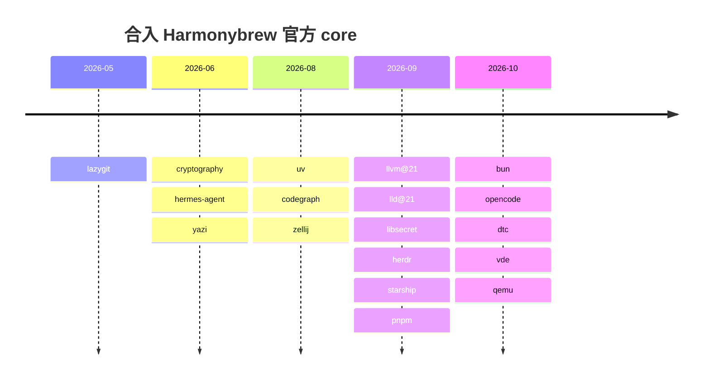

# Harmonybrew 第三方 tap · 鸿蒙 PC 工具链

致力于补齐鸿蒙 PC 工具链，`brew install` 即装即用。[Harmonybrew](https://harmonybrew.atomgit.com) 是 Homebrew 的鸿蒙移植。npm 包的鸿蒙适配在社区仓 [ohos-npm-ports](https://github.com/ohos-npm-ports/ohos-npm-ports)，npm 包装不上或跑不起来时先去那里找。

## 快速开始

```bash
brew tap social4hyq/core https://atomgit.com/social4hyq/homebrew-core.git
brew trust social4hyq/core   # 显式信任第三方 tap

brew install social4hyq/core/claude-code # 本 tap：Claude Code CLI
brew install vite-plus                  # 本 tap：前端工具链（vp 命令）
brew install hishell-font               # 本 tap：终端图标字体
```

`claude-code` 与 `claude-code.latest` 分别跟随 stable、latest 频道，两者不能同时安装。安装时可能需要联网下载官方程序，具体以对应 [Formula](Formula/c/) 为准。

## 合入进度

formula 成熟后合入 [Harmonybrew 官方 core](https://atomgit.com/Harmonybrew/homebrew-core)，本 tap 随之下线自有版本。



| Formula | 作用 | 状态 | MR |
|---|---|---|---|
| [`lazygit`](https://harmonybrew.atomgit.com/packages/#formula/lazygit) | Git 终端界面，在终端里用键盘完成暂存、提交、分支、rebase 等操作 | ✅ 已合入 | [!8586](https://gitcode.com/Harmonybrew/homebrew-core/merge_requests/8586) |
| [`cryptography`](https://harmonybrew.atomgit.com/packages/#formula/cryptography) | Python 事实标准的加密库，SSH、TLS、证书、JWT 等大量 Python 库的底层依赖 | ✅ 已合入 | [!10480](https://gitcode.com/Harmonybrew/homebrew-core/merge_requests/10480) |
| [`hermes-agent`](https://harmonybrew.atomgit.com/packages/#formula/hermes-agent) | Nous Research 的自我进化 AI Agent，能从经验中沉淀出可复用的技能 | ✅ 已合入 | [!10485](https://gitcode.com/Harmonybrew/homebrew-core/merge_requests/10485) |
| [`yazi`](https://harmonybrew.atomgit.com/packages/#formula/yazi) | Rust 编写、异步 I/O 的极速终端文件管理器，支持预览与插件 | ✅ 已合入 | [!10780](https://gitcode.com/Harmonybrew/homebrew-core/merge_requests/10780) |
| [`uv`](https://harmonybrew.atomgit.com/packages/#formula/uv) | Rust 编写的极速 Python 包安装器与解析器，可替代 pip、venv 等 | ✅ 已合入 | [!17130](https://gitcode.com/Harmonybrew/homebrew-core/merge_requests/17130) |
| [`codegraph`](https://harmonybrew.atomgit.com/packages/#formula/codegraph) | 面向 AI coding agent 的预索引代码知识图谱，全本地运行，让 agent 少读文件、省 token | ✅ 已合入 | [!17567](https://gitcode.com/Harmonybrew/homebrew-core/merge_requests/17567) |
| [`zellij`](https://harmonybrew.atomgit.com/packages/#formula/zellij) | 可扩展的终端工作区，以终端复用器为基础，支持 WASM 插件 | ✅ 已合入 | [!17569](https://gitcode.com/Harmonybrew/homebrew-core/merge_requests/17569)（[!18645](https://gitcode.com/Harmonybrew/homebrew-core/merge_requests/18645)） |
| [`llvm@21`](https://harmonybrew.atomgit.com/packages/#formula/llvm@21) | 现代编译器基础设施（clang 等），C/C++ 等原生工具链的基础 | ✅ 已合入 | [!18194](https://gitcode.com/Harmonybrew/homebrew-core/merge_requests/18194) |
| [`lld@21`](https://harmonybrew.atomgit.com/packages/#formula/lld@21) | LLVM 的链接器，链接速度快 | ✅ 已合入 | [!18536](https://gitcode.com/Harmonybrew/homebrew-core/merge_requests/18536) |
| [`libsecret`](https://harmonybrew.atomgit.com/packages/#formula/libsecret) | GNOME 的密钥存储库，不少 CLI 工具靠它安全保存密码和令牌 | ✅ 已合入 | [!18633](https://gitcode.com/Harmonybrew/homebrew-core/merge_requests/18633) |
| [`herdr`](https://harmonybrew.atomgit.com/packages/#formula/herdr) | 住在终端里的 Agent 复用器，一个界面管理多个 coding agent 会话 | ✅ 已合入 | [!18651](https://gitcode.com/Harmonybrew/homebrew-core/merge_requests/18651)（[!20617](https://gitcode.com/Harmonybrew/homebrew-core/merge_requests/20617)、[!20719](https://gitcode.com/Harmonybrew/homebrew-core/merge_requests/20719)） |
| [`starship`](https://harmonybrew.atomgit.com/packages/#formula/starship) | 跨 shell 的极简、高度可定制的终端提示符 | ✅ 已合入 | [!18673](https://gitcode.com/Harmonybrew/homebrew-core/merge_requests/18673)（[!18770](https://gitcode.com/Harmonybrew/homebrew-core/merge_requests/18770)） |
| [`pnpm`](https://harmonybrew.atomgit.com/packages/#formula/pnpm) | 快速、省磁盘的 Node 包管理器 | ✅ 已合入 | [!20806](https://gitcode.com/Harmonybrew/homebrew-core/merge_requests/20806) |
| [`bun`](https://harmonybrew.atomgit.com/packages/#formula/bun) | 集运行时、包管理、测试、打包于一体的极速 JavaScript 工具链 | ✅ 已合入 | [!21450](https://gitcode.com/Harmonybrew/homebrew-core/merge_requests/21450) |
| [`opencode`](https://harmonybrew.atomgit.com/packages/#formula/opencode) | 开源的终端 AI 编程助手，支持多种模型提供商 | ✅ 已合入 | [!21455](https://gitcode.com/Harmonybrew/homebrew-core/merge_requests/21455) |
| [`dtc`](https://harmonybrew.atomgit.com/packages/#formula/dtc) | 设备树工具链：编译、反编译 DTS/DTB，并提供 libfdt 与配套操作工具 | ✅ 已合入 | [!21461](https://gitcode.com/Harmonybrew/homebrew-core/merge_requests/21461) |
| [`vde`](https://harmonybrew.atomgit.com/packages/#formula/vde) | 用户态虚拟以太网交换与连接工具，可将虚拟机、进程和网络命名空间接入虚拟网络 | ✅ 已合入 | [!22650](https://gitcode.com/Harmonybrew/homebrew-core/merge_requests/22650) |
| [`qemu`](https://harmonybrew.atomgit.com/packages/#formula/qemu) | 通用机器模拟器与虚拟化器：可运行完整客户机系统或跨架构用户态程序，并提供磁盘镜像工具 | ✅ 已合入 | [!24240](https://gitcode.com/Harmonybrew/homebrew-core/merge_requests/24240) |
| `vite-plus` | VoidZero 的 Web 统一工具链，一个 `vp` 命令覆盖创建、开发、检查、格式化、测试、构建 | 计划合入 | — |
| `zcode` | AI 编程工作台，终端 agent（TUI）与 Web IDE 双形态 | 已下线（公开源码更新滞后于产品发布，维护投入与收益不匹配） | — |
| `ohos-compat-shim` | 兜底鸿蒙与标准 Linux 底层差异的 LD_PRELOAD 兼容层，随 `claude-code.latest` 自动安装 | 待定 | — |
| `claude-code` / `claude-code.latest` | Anthropic 官方 Claude Code 终端版（stable / latest 两个频道） | 无计划（闭源，只能拉取官方二进制） | — |
| `sshport` | 把远程开发机的服务端口映射到本机同名端口 | 无计划（内部小工具） | — |
| `hishell-font` | 为鸿蒙 PC 终端（HiShell）安装并配置 Nerd Font | 无计划（内部小工具） | — |

已合入的 Formula 名称链接到官方软件包页面；MR 栏括号内为后续修复。已下线条目仅作记录，不代表仍可安装。

## 迁移说明

上表「已合入」的 formula，以及 `codex`、`cc-switch`、`reasonix`、`deepseek-harness`、`nvm`、`ohos-bst-light`、`node-ohos`，现已由官方 core 提供。已安装本 tap 旧版的用户，先卸载旧包，再安装官方包（以下以 bun 为例）：

```bash
brew update
brew uninstall social4hyq/core/bun
brew install bun
```

通常官方名与旧名相同，以下几项例外：

| 本 tap 旧名 | 官方名 | 备注 |
|---|---|---|
| `cc-switch` | [`cc-switch-cli`](https://harmonybrew.atomgit.com/packages/#formula/cc-switch-cli) | |
| `node-ohos` | [`node`](https://harmonybrew.atomgit.com/packages/#formula/node) | |
| `ohos-bst-light` | [`ohos-selfsign`](https://harmonybrew.atomgit.com/packages/#formula/ohos-selfsign) | 命令由 `self-sign` 改为 `selfsign` |

`opencode-v1` 已停止维护；官方 `opencode` 为 v2，不是 v1 的原样替代。其余下线项与改名记录见 [docs/offline-history.md](docs/offline-history.md)。

## 已知限制

鸿蒙 PC 对原生可执行文件和动态库有代码签名要求；自行编译或下载的未签名二进制可能因 `Permission denied` 无法运行。纯 JS/TS 脚本不需要二进制签名。

`ohos-compat-shim` 只处理部分已知的系统调用与运行库差异，并非所有工具都会自动加载。需要诊断时可运行 `ohos-shim check`，兼容层的使用方式见其[项目说明](https://github.com/social4hyq/ohos-compat-shim)。历史限制与排查线索见 [docs/known-limitations.md](docs/known-limitations.md)；具体表现以当前系统和工具版本为准。

## 反馈与仓库

问题请到 [GitHub Issues](https://github.com/social4hyq/homebrew-core/issues) 反馈，附 HarmonyOS 版本、`<工具> --version`、复现命令。本仓库以 GitHub 为唯一源头；[atomgit 同名仓库](https://atomgit.com/social4hyq/homebrew-core) 是单向镜像，只为国内更快下载 bottle，请勿向其推送或开 PR。

## 致谢

感谢 **hqzing** 的《鸿蒙 PC 底层开发技术详解》系列和开源的自签工具 `ohos-bst-light`，为本 tap 提供了重要参考：

- 《鸿蒙 PC 底层开发技术详解（四）：代码签名机制对我们的影响》 — https://blog.csdn.net/hqzing/article/details/160746583
- 《鸿蒙 PC 底层开发技术详解（七）：二进制自签名算法的实现》 — https://blog.csdn.net/hqzing/article/details/162642397
- 《鸿蒙 PC 底层开发技术详解（八）：鸿蒙 PC 上的问题定位手段》 — https://blog.csdn.net/hqzing/article/details/163311519
- 《在鸿蒙 PC 上使用 Claude Code（最新的 Bun 版本）》 — https://blog.csdn.net/hqzing/article/details/162758675
